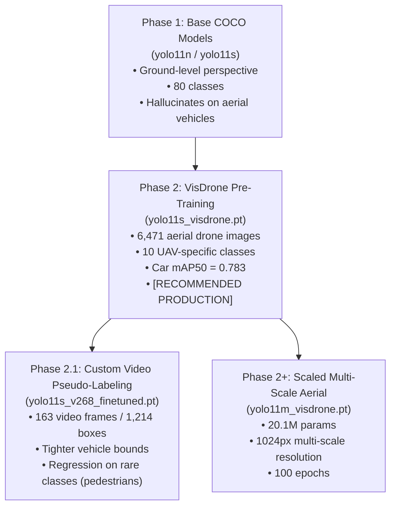

# UAV Intelligence Engine — Model Registry & Phase Catalog

This directory contains the machine learning models and weights used for object detection, classification, and tracking in high-altitude and tactical UAV aerial footage.

To maintain reproducibility and prevent confusion between training stages, every model is cataloged by its **developmental phase**, with its exact provenance, training methodology, benchmark metrics, operational strengths, and known failure modes clearly stated.

---

## Model Selection & Active Configuration

To select which model the inference pipeline uses, edit [`config/paths.yaml`](file:///c:/Users/A%20Bhargav/Downloads/Phase1_Phase2_Setup/UAV_Intelligence_Engine/config/paths.yaml):

```yaml
models:
  # Active model for inference and tracking:
  yolo_weights: models/yolo/yolo11s_visdrone.pt      # [RECOMMENDED for Aerial UAV]
  # yolo_weights: models/yolo/yolo11s_v268_finetuned.pt  # [Phase 2.1 Custom Video Experiment]
  # yolo_weights: models/yolo/yolo11n.pt             # [Phase 1 Baseline COCO Rollback]
```

---

## Integrity & Cryptographic Hashes (SHA-256)

All models must pass SHA-256 checksum verification before being transferred to air-gapped facility PCs. Refer to [`models/yolo/hashes.sha256`](file:///c:/Users/A%20Bhargav/Downloads/Phase1_Phase2_Setup/UAV_Intelligence_Engine/models/yolo/hashes.sha256).

| File | Size | SHA-256 Checksum | Phase | Recommended Use |
| :--- | :--- | :--- | :--- | :--- |
| `yolo11s_visdrone.pt` | 18.3 MB | `496A7C9D44DD71053BC7E811D8FF98789541A04B5E6DE86FA0F39C5C2910725A` | **Phase 2** | **Primary UAV Aerial Model (Production)** |
| `yolo11s_v268_finetuned.pt` | 18.4 MB | `6D593548D40BA87D7C67CF5C4C2E710679802EE790DFC2CE212C425D0539E405` | **Phase 2.1** | Experimental (Scene-specific transfer) |
| `yolo11s.pt` | 18.4 MB | `85A76FE86DD8AFE384648546B56A7A78580C7CB7B404FC595F97969322D502D5` | **Phase 1** | Baseline COCO (Ground-level reference) |
| `yolo11n.pt` | 5.4 MB | `0EBBC80D4A7680D14987A577CD21342B65ECFD94632BD9A8DA63AE6417644EE1` | **Phase 1** | Lightweight COCO (CPU edge fallback) |
| `yolo11m.pt` | 38.8 MB | `D5FFC1A674953A08E11A8D21E022781B1B23A19B730AFC309290BD9FB5305B95` | **Phase 1** | Base COCO weights for Phase 2+ medium training |

---

## Detailed Model Catalog by Developmental Phase



---

### Phase 2: `yolo11s_visdrone.pt` (⭐ Recommended Primary Aerial Model)

* **Architecture**: YOLOv11 Small (9.4M parameters)
* **Dataset**: VisDrone 2019-DET (6,471 train images, 548 validation images)
* **Classes (10)**: `pedestrian`, `people`, `bicycle`, `car`, `van`, `truck`, `tricycle`, `awning-tricycle`, `bus`, `motor`
* **Training Hyperparameters**:
  * Base: `yolo11s.pt`
  * Epochs: 50
  * Image Size: 640px
  * Optimizer: AdamW (lr0=0.001, lrf=0.01)
  * Augmentations: `mosaic=1.0`, `copy_paste=0.3`, `scale=0.5`, `degrees=10.0`
  * Device: NVIDIA RTX 4060 Laptop GPU (1h 20m training time)

#### Why It Was Trained:
Standard YOLO models trained on COCO fail catastrophically on drone footage because they are trained on eye-level, horizontal photographs. From a high-altitude UAV viewpoint, vehicles are seen from their roof and bonnet, and pedestrians appear as small vertical dots. The VisDrone transfer learning trained the model on genuine drone-captured aerial surveillance imagery.

#### Real-World Performance on 4K Aerial Video (`v268.mp4`):
* **Car mAP50**: `0.783` | Recall: `0.787` | Precision: `0.687`
* **Van mAP50**: `0.444` | Recall: `0.433`
* **Bus mAP50**: `0.532` | Recall: `0.466`
* **Truck mAP50**: `0.386` | Recall: `0.368`
* **Pedestrian mAP50**: `0.420` | Recall: `0.408`
* **Total Detections Logged**: 4,935 across 978 frames
* **Unique Physical Tracks**: 160

#### What This Model IS:
* A robust, general-purpose aerial object detector calibrated for vehicles, convoys, and city traffic seen from low-to-medium UAV altitudes (20m to 100m AGL).
* Completely immune to the false "train" misclassifications seen with COCO base weights.
* Fully compatible with SAHI (Sliced Inference) for high-resolution 4K frames.

#### What This Model IS NOT:
* It is not a specialist for extreme high-altitude (>300m AGL) footage without SAHI tiling enabled (`yolo_inference_size` ≥ 2048).
* It does not classify military-specific vehicles (e.g. tanks, armored personnel carriers) under custom nomenclature—it uses the VisDrone 10-class taxonomy.

---

### Phase 2.1: `yolo11s_v268_finetuned.pt` (Custom Video Pseudo-Label Experiment)

* **Architecture**: YOLOv11 Small (9.4M parameters)
* **Dataset**: Custom auto-annotated dataset extracted from `v268.mp4` (163 frames, 1,214 pseudo-labeled bounding boxes; 139 train, 24 val)
* **Classes**: 10 VisDrone classes
* **Training Hyperparameters**:
  * Base: `yolo11s_visdrone.pt`
  * Epochs: 21 (early stopped by `patience=20`, best weights at epoch 1)
  * Image Size: 1280px
  * Optimizer: AdamW (lr0=0.0001, low learning rate to avoid catastrophic forgetting)
  * Freezing: First 10 backbone layers frozen; only detection head trained
  * Augmentations: `mosaic=1.0`, `copy_paste=0.5`, `degrees=45.0`

#### Why It Was Trained:
To test the hypothesis of **self-supervised pseudo-label transfer learning**: can a UAV model adapt its detection head to the exact lighting, camera lens distortion, and altitude of a specific deployment video without requiring human manual annotation?

#### Evaluation Findings & Scientific Analysis:
1. **Validation on Self-Annotated Frames**: mAP50 reported `0.880` on the 24 validation frames.
2. **Full Video Benchmark (978 frames)**:
   * Car mAP50 stayed identical at `0.783`.
   * Total detections dropped from 4,935 to 3,838.
   * Pedestrian detections dropped from 138 to 0.
3. **The Pseudo-Label Confirmation Bias**:
   Because pseudo-labels were generated by the model itself, borderline confidence detections (like distant pedestrians at ~0.29 confidence) were omitted during auto-annotation. Fine-tuning on these sparse labels taught the model to become overly conservative on rare classes while confirming its existing vehicle biases.

#### What This Model IS:
* A valuable reference benchmark demonstrating the limits of closed-loop unassisted pseudo-labeling.
* Excellent vehicle detector with higher confidence on clean car silhouettes in identical conditions to `v268.mp4`.

#### What This Model IS NOT:
* **Not recommended over `yolo11s_visdrone.pt` for general deployment.**
* Do NOT use this model if human/pedestrian detection is a mission requirement.

---

### Phase 1: Base COCO Models (`yolo11n.pt`, `yolo11s.pt`, `yolo11m.pt`)

* **Architecture**: Ultralytics YOLOv11 (Nano: 2.6M params, Small: 9.4M params, Medium: 20.1M params)
* **Dataset**: MS COCO (80 everyday object classes, ~118k ground-level images)
* **Status**: Baseline / Fallback Reference

#### Why They Are Retained:
* `yolo11n.pt`: Used for rapid unit testing (e.g., `tests/test_vision.py`) and minimal-resource CPU edge deployments.
* `yolo11s.pt`: Provides the architectural base for Phase 2 VisDrone fine-tuning.
* `yolo11m.pt`: Downloaded base weights for Phase 2+ high-capacity training.

#### Severe Limitations in UAV Domain:
* **Severe Perspective Mismatch**: Misidentifies aerial vehicle rooftops as "train" (388 false train detections observed on `v268.mp4`), "boat", or "suitcase".
* **Zero Overhead Pedestrian Recall**: Completely blind to human top-down silhouettes because COCO only contains upright standing humans.

---

## Model Selection Guidelines for Operators

| Operational Scenario | Recommended Model | Config Setting |
| :--- | :--- | :--- |
| **Tactical UAV Surveillance (Standard Mission)** | `yolo11s_visdrone.pt` | `yolo_weights: models/yolo/yolo11s_visdrone.pt` |
| **High-Altitude 4K Small-Target Search** | `yolo11s_visdrone.pt` + SAHI (512x512 tiles, 30% overlap) | `sahi.enabled: true` in `ontology.yaml` |
| **Long Duration Video (>10 minutes)** | `yolo11s_visdrone.pt` via `scripts/process_clips.py` | `py -3.10 scripts/process_clips.py --clip-length 60` |
| **Fast Offline Testing / Edge CPU** | `yolo11n.pt` | `yolo_weights: models/yolo/yolo11n.pt` |
